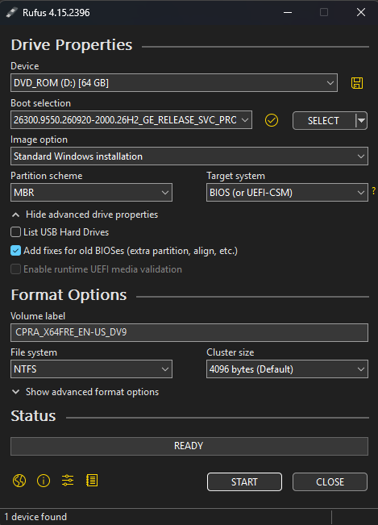
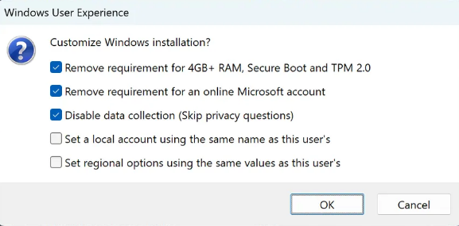
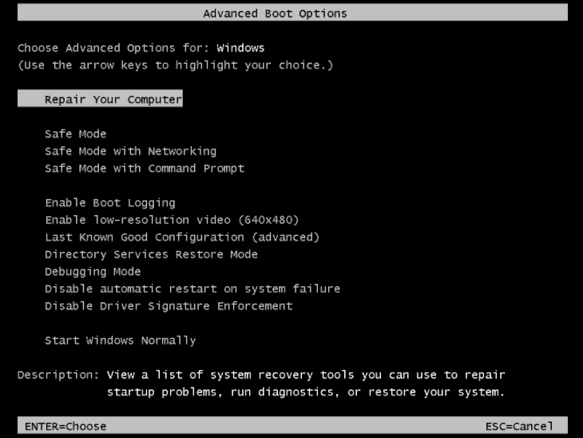
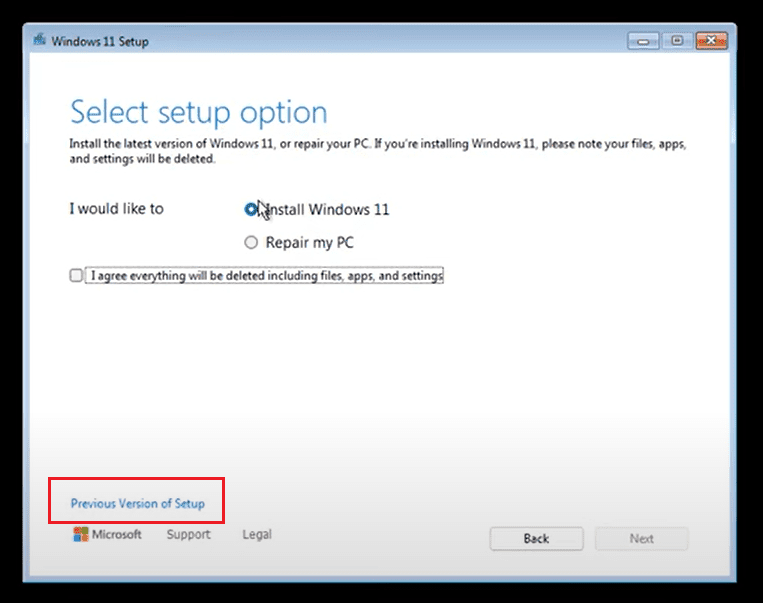
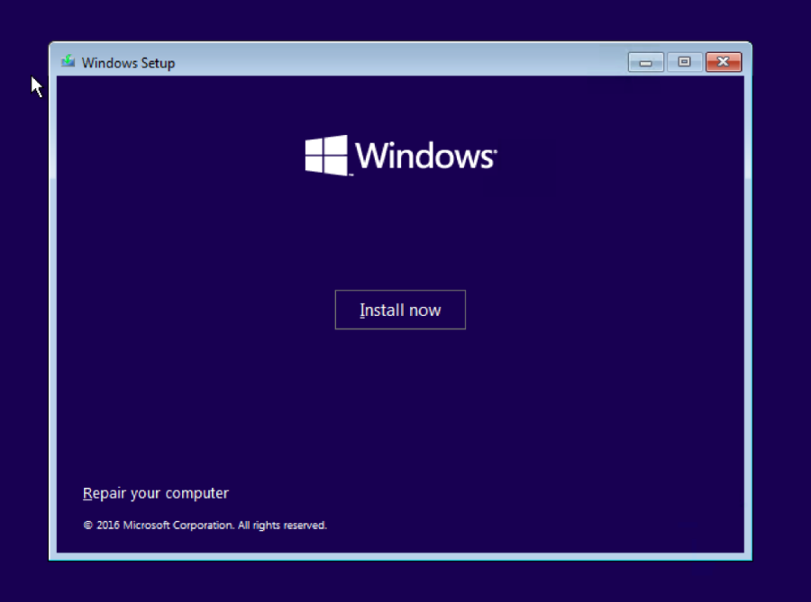
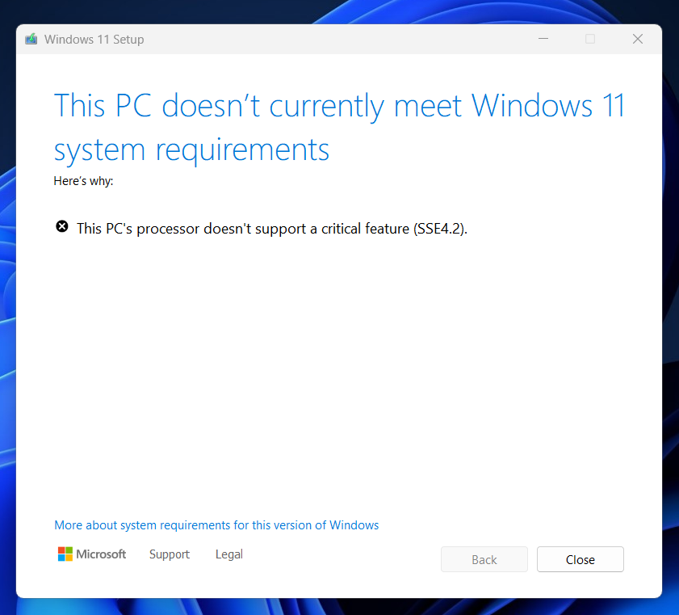
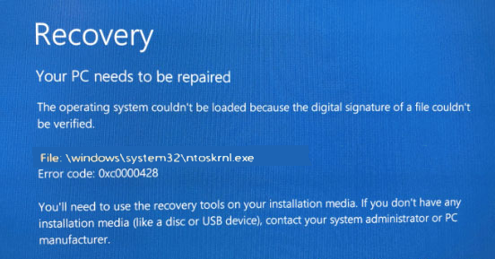
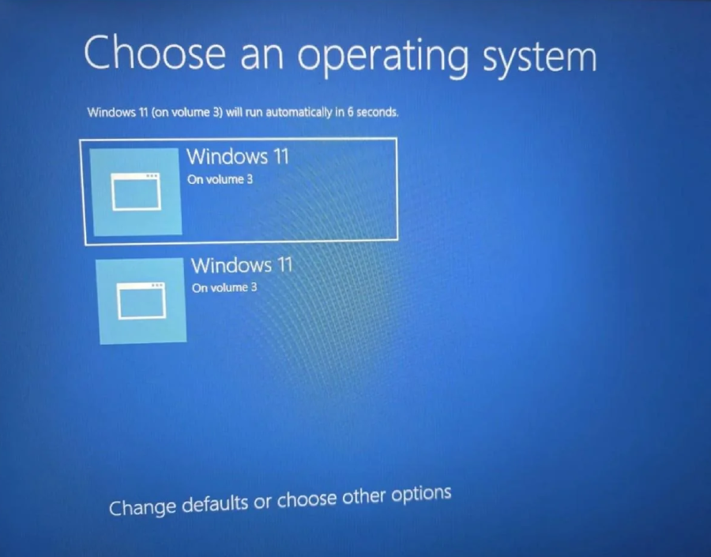
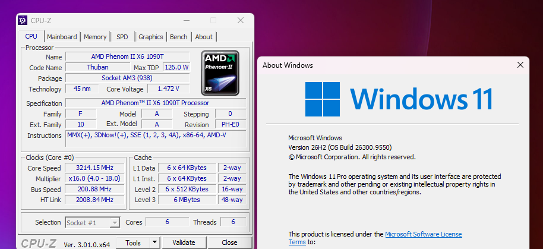

# Patching and Installing Windows 11 26H2 Walkthrough

> **Status of this walkthrough:** This records a real full installation attempt using POP4.2 and Windows 11 26H2 build `26300.9550` on an AMD Phenom II system. 
> POP4.2 is experimental. Windows 11 on unsupported hardware is not supported by Microsoft. Back up all important data and prepare recovery media before starting.


### In-place upgrades

In-place upgrades from the existing Windows 11 23H2 system were attempted with 24H2, 25H2 and 26H2 media. These attempts did not succeed, including attempts using Rufus-created media. Invoking Setup through `setupprep.exe` with `/Product Server`, including an attempt with `/MigrateDrivers None`, failed in the SafeOS/boot transition with:

```text
0xC1900101-0x20017
```

## 1. Test configuration

The procedure below reflects this test machine:

- **CPU:** AMD Phenom II (K10), supports POPCNT but does not support SSE4.2.
- **Motherboard/firmware:** Gigabyte GA-890GPA-UD3H; legacy Award BIOS.
- **Boot layout:** Legacy BIOS with an MBR system disk.
- **Previous OS:** Windows 11 23H2, build `22631`.
- **Target image:** Windows 11 26H2 x64, English (US), build `26300.9550`.

Other CPU families, firmware modes, image builds, and editions have not been established by this test. The process may differ for UEFI systems or other releases.

## 2. What is required

- A Windows 11 26H2 x64 ISO. For this test, the ISO was generated from UUP files for build `26300.9550`.
- A Windows 11 23H2 x64 image from which the replacement DLLs listed below can be extracted.
- The POP4.2 source and its Python prerequisites.
- Rufus and a USB drive large enough for the resulting installation media.
- A separate Windows recovery USB or another way to restore the existing installation.
- A backup of the target disk. **A clean installation can erase data if the wrong partition is selected.**

See the [POP4.2 README](https://github.com/Smu1zel/POP4.2/blob/master/README.md) for current project prerequisites and changes. Use the revision being tested or documented rather than assuming every future version behaves identically.

## 3. Prepare POP4.2 and the 23H2 replacement DLLs

1. Obtain the latest POP4.2 source. To reproduce the source revision used in this test, check out:

   ```text
   git clone https://github.com/Smu1zel/POP4.2.git
   ```

2. Install the Python dependency in an elevated or appropriately configured Python environment:

   ```powershell
   py -m pip install pefile
   ```

   The script may request Administrator elevation for Windows image mounting and offline registry/BCD work. The project README also documents its Windows ADK `oscdimg.exe` prerequisite; the builder can download it if needed.

3. Extract these files from a **Windows 11 23H2 x64 image** into the repository's `blobs` directory. Use the correct 64-bit or 32-bit source for each path:

   | Source path inside the mounted 23H2 Windows image | Destination under `POP4.2\blobs` |
   | --- | --- |
   | `Windows\System32\WindowsCodecs.dll` | `WindowsCodecs.dll` |
   | `Windows\System32\msxml6.dll` | `msxml6.dll` |
   | `Windows\SysWOW64\msxml6.dll` | `msxml6_wow64.dll` |

   Do not substitute the target 26H2 versions. POP4.2 documents these 23H2 replacements as important workarounds for SSE4.1 instructions in `WindowsCodecs.dll` and `msxml6.dll`; omitting them can make Setup or post-install registration fail.

   Here is an example Powersheel script you can customise to copy the above .dll files. Don't assume everything matches on your system, double check and adjust paths, filenames and indexes.

      ```powershell
      $Iso = 'C:\POP42\Win11_23H2_English_x64.iso'
      Mount-DiskImage -ImagePath $Iso
      $Drive = (Get-DiskImage -ImagePath $Iso | Get-Disk | Get-Partition | Get-Volume).DriveLetter
      $Wim = "${Drive}:\sources\install.wim"

      DISM /Get-WimInfo /WimFile:$Wim
      New-Item -ItemType Directory -Force 'C:\POP42\Mount23H2' | Out-Null
      DISM /Mount-Image /ImageFile:$Wim /Index:1 /MountDir:'C:\POP42\Mount23H2' /ReadOnly

      New-Item -ItemType Directory -Force 'C:\POP42\blobs' | Out-Null
      Copy-Item 'C:\POP42\Mount23H2\Windows\System32\WindowsCodecs.dll' 'C:\POP42\blobs\WindowsCodecs.dll' -Force
      Copy-Item 'C:\POP42\Mount23H2\Windows\System32\msxml6.dll' 'C:\POP42\blobs\msxml6.dll' -Force
      Copy-Item 'C:\POP42\Mount23H2\Windows\SysWOW64\msxml6.dll' 'C:\POP42\blobs\msxml6_wow64.dll' -Force

      DISM /Unmount-Image /MountDir:'C:\POP42\Mount23H2' /Discard
      Dismount-DiskImage -ImagePath $Iso
      ```

## 4. Configure the patch profile

Review `badblobs.xml` before building. The test used these actions:

- All three `winload` entries enabled, with `patch_ci_filter=true` and `patch_boot_options=true`:
  - `Windows\System32\boot\winload.efi`
  - `Windows\System32\winload.efi`
  - `Windows\System32\winload.exe` (**the legacy-BIOS loader used by the test machine**)


## 5. Build the patched 26H2 ISO

The source ISO of Windows 11 26H2 used in the test was named:

```text
26300.9550.260920-2000.26H2_GE_RELEASE_SVC_PROD3_CLIENTPRO_OEMRET_X64FRE_EN-US.ISO
```

The exact build command used was:

```powershell
python pop42.py build -i "C:\POP42\26300.9550.260920-2000.26H2_GE_RELEASE_SVC_PROD3_CLIENTPRO_OEMRET_X64FRE_EN-US.ISO" -o "C:\POP42\Win11_26H2_POP42_WinloadPatched.iso" --index 1
```

Adjust paths and the image index for your own files. The test image's index `1` was Windows 11 Pro. Check the source ISO's indexes before building; do not assume index `1` is Pro in every ISO.

The output ISO was then used as the source for the Rufus USB. Keep the original unmodified ISO and the patched ISO separate so it is clear which image was written to the USB.

## 6. Create the USB with Rufus

1. Open Rufus and select `Win11_26H2_POP42_WinloadPatched.iso`.
2. For a system using the same legacy BIOS/MBR configuration as the test, choose an MBR/BIOS-compatible layout and confirm that the USB boots in legacy mode. Rufus labels may vary by version. If you have UEFI BIOS don't select MBR.
3. Once you start USB writing, customise the Windows installation and **Remove requirement for 4GB+ RAM, Secure Boot and TPM 2.0**
4. Write the USB and boot the target computer from it in legacy BIOS mode. 

  


## 7. Start Setup using the "Previous Version Setup" option

With the USB booted, press **F8** to open the Advanced Boot Options and choose **Disable Driver Signature Enforcement**. Menu wording and key behaviour may depend on boot stage Windows version.

When the process offers the new white Setup UI look for a link in bottom left of the screen called **Previous Version Setup** and click it. 

Proceed with a **Full clean installation**, not an in-place upgrade. Choose the target disk and partitions carefully. 

  
  
  

If you don't pick Previous Version Setup the newer white Setup UI blocks installation at the SSE4.2 CPU check, while the previous method allows the installation to proceed.



## 8. First reboot: observed boot-menu behaviour

The first restart after image application displayed a signature-verification error for the modified kernel (`\Windows\System32\ntoskrnl.exe`, error `0xc0000428`. 


Press **F9** to choose another operating-system entry. The menu showed two entries named **Windows 11**, both associated with **Volume 3**. Selecting the **top entry** failed to boot. Selecting the **bottom entry** continued Setup; it displayed the Windows logo and spinning dots, then proceeded through another automatic reboot to **“Just a moment”** without requiring further input.



This is an observation from one machine, not a general rule. Do **not** blindly select the bottom entry on every computer: menu order, volume numbering and BCD entries can differ.  The important result to verify is that Setup continues rather than returning to the old OS or entering recovery.

Let Setup continue. Do not interrupt it just because disk activity is heavy or because it restarts more than once.

## 9. Verify the result

```powershell
winver
```


Do not install cumulative updates until the initial system is verified and backed up. Modified protected binaries may be replaced by servicing, and this is an unsupported configuration.

## 10. Windows Updates

Use Group Policy to configure Windows Updates to only notify of updates but not update as that could make your machine fail to boot after an update.
Review update notes to check if update is updating any of the modified boot files or the three .dll files. Where those are updated you can explore creating an ISO with UUP that contains the update but note that this is not guaranteed to work.


